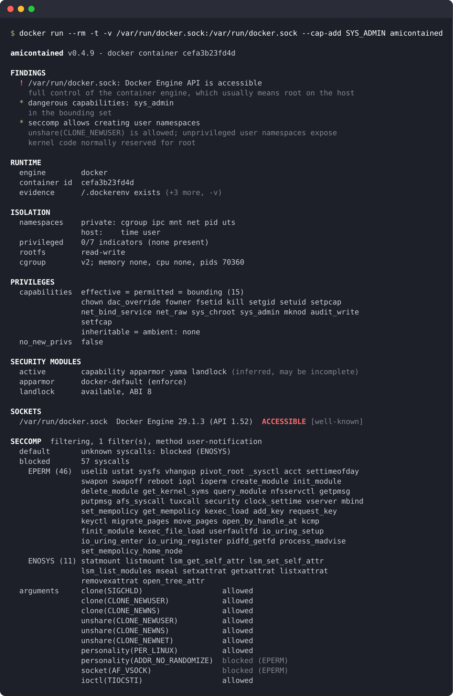
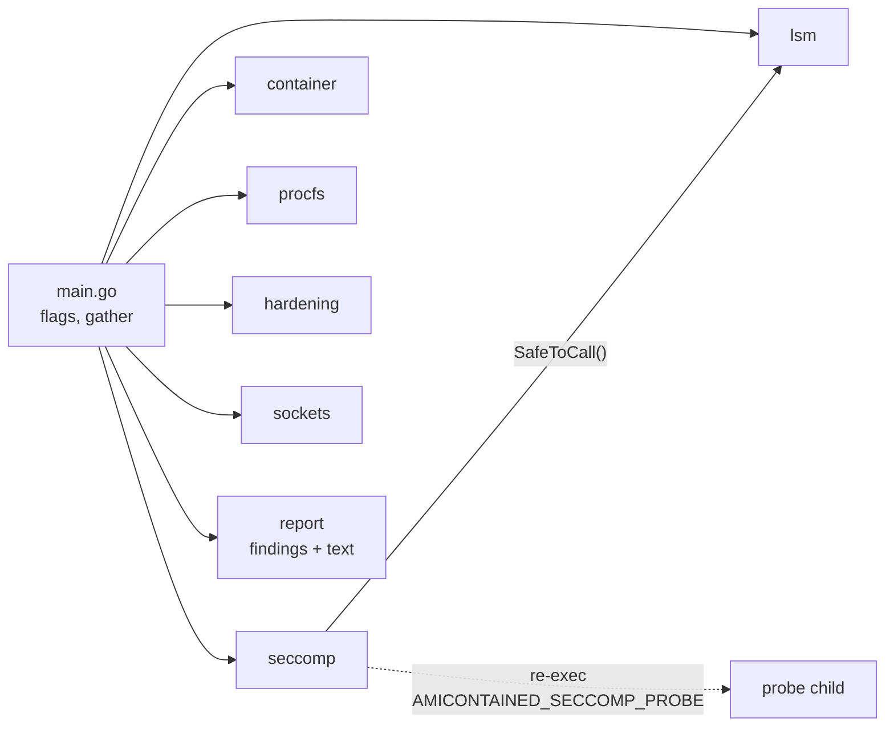

# amicontained

A container introspection tool. Run it inside a container and it tells you
what sort of container you are in and how well it is isolated: which runtime
started it, which namespaces it shares with the host, what capabilities and
security modules apply, whether it looks privileged, which container-engine
sockets it can reach, and exactly which syscalls the seccomp policy blocks.



This is a maintained fork of
[genuinetools/amicontained](https://github.com/genuinetools/amicontained) by
Jess Frazelle, which is no longer maintained. The seccomp assessment, runtime
detection and most of the checks have been rewritten; the output format has
changed accordingly.

- [What it checks](#what-it-checks)
- [Installing](#installing)
- [Usage](#usage)
- [Reading the output](#reading-the-output)
- [What it does to the environment](#what-it-does-to-the-environment)
- [Architecture](#architecture)
- [Development](#development)
- [Limitations](#limitations)

## What it checks

| Area | What is reported |
|---|---|
| Runtime | Engine (Docker, Podman, containerd, CRI-O, LXC, systemd-nspawn, OpenVZ, Garden), Kubernetes, gVisor, Kata Containers, container ID, pod UID, and the evidence for each |
| Namespaces | All eight types (cgroup, ipc, mnt, net, pid, time, user, uts): shared with the host or private, plus user-namespace ID mappings |
| Privileges | All five capability sets, `no_new_privs` |
| Security modules | Active LSMs, the AppArmor/SELinux/Smack label and whether it actually confines, Landlock availability |
| Privileged indicators | Host devices, writable `/sys` and `/proc/sys`, unmasked `/proc` paths, full capability set, seccomp off, no LSM confinement |
| Filesystem and cgroups | Read-only root, cgroup version, memory/CPU/pids limits |
| Sockets | Docker, Podman, containerd, CRI-O, kubelet and other sockets, which API answers on each and whether it is usable |
| Seccomp | Mode, the action for every syscall (allowed, which errno, kill, trap), the default action for unknown syscalls, and argument-filtered calls such as `clone(CLONE_NEWUSER)` |

The output starts with a short list of **findings**: only the ways this
environment differs from a default, isolated container.

## Installing

Static binaries for linux/amd64 and linux/arm64 are attached to each
[release](https://github.com/raesene/amicontained/releases):

```bash
VERSION=0.4.9   # release tag without the leading "v"
ARCH=amd64      # or arm64
curl -fsSLO "https://github.com/raesene/amicontained/releases/download/v${VERSION}/amicontained_${VERSION}_linux_${ARCH}.tar.gz"
tar -xzf "amicontained_${VERSION}_linux_${ARCH}.tar.gz" amicontained
```

Or build it (Go 1.26+, no C toolchain needed):

```bash
git clone https://github.com/raesene/amicontained && cd amicontained
make static                      # produces ./amicontained
docker build -t amicontained .   # or a 7 MB image FROM scratch
```

## Usage

The binary is static, so you can drop it into any container. It is meant to
run *inside* the environment you want to assess:

```bash
# Docker / Podman: mount the binary in
docker run --rm -v "$PWD/amicontained:/amicontained:ro" alpine /amicontained

# The image
docker run --rm amicontained

# Kubernetes: copy it into a running pod
kubectl cp ./amicontained mypod:/tmp/amicontained
kubectl exec mypod -- /tmp/amicontained
```

Running it on a host rather than in a container works, but read
[What it does to the environment](#what-it-does-to-the-environment) first.

| Flag | Default | Meaning |
|---|---|---|
| `-v` | off | Full details instead of summaries: all runtime evidence, every privileged indicator, every socket, capability hex, allowed syscalls |
| `-json` | off | Machine-readable output with everything, including the findings |
| `-no-color` | off | Disable colour. Colour is also off when output is not a terminal or `NO_COLOR` is set |
| `-seccomp-method` | `auto` | `notify` (exact, Linux 5.0+), `heuristic` (fallback), `auto` (notify, else heuristic) or `none` |
| `-sockets` | `scan` | `scan` (well-known paths plus a bounded filesystem walk), `known` (well-known paths only) or `none` |
| `-d` | off | Debug logging on stderr |
| `-version` | | Print version information (also `amicontained version`) |

## Reading the output

### Findings

Each finding is marked by how much it matters:

- `!` **high**: isolation is effectively broken. For example an accessible
  Docker, Podman, containerd or CRI-O socket, a container that looks
  `--privileged`, seccomp disabled, or a shared host pid, net or mount
  namespace.
- `*` **medium**: isolation is weakened. For example dangerous capabilities
  such as `sys_admin` or `sys_ptrace`, no LSM confinement, a seccomp policy
  that allows creating user namespaces, a shared ipc/uts/cgroup namespace, or
  a mounted Kubernetes service account token.
- `i` **info**: context you need to read the rest correctly, such as running
  inside gVisor or Kata Containers, or seccomp results that came from the
  heuristic method. Inside a sandbox, kernel-level findings (namespaces,
  capabilities, seccomp, LSMs, privileged indicators) describe gVisor's
  kernel or the pod VM's guest kernel rather than the host, so they are
  reported as info and say which sandbox they apply to. Findings that cross
  the sandbox boundary, such as engine sockets and service account tokens,
  keep their severity.

"none: this looks like a default, isolated container" means nothing stood
out. The sections below the findings always hold the full picture.

### Sections

- **RUNTIME**: the engine and how it was identified. Every signal that matched
  is kept as evidence (marker files like `/.dockerenv`, host paths visible in
  `/proc/self/mountinfo`, cgroup paths, Kubernetes environment).
- **ISOLATION**: namespaces as `private` or `host`. A `?` marks an answer
  inferred from inode allocation order (net and mnt on kernels before 7.0);
  the rest are exact. The privileged indicators score up to 7: `--privileged`
  sets all of them, and a default Docker container sets none.
- **PRIVILEGES**: capability sets. Identical sets are printed once, e.g.
  `effective = permitted = bounding (14)`.
- **SECURITY MODULES**: the active LSMs and labels. A label can exist without
  restricting anything (AppArmor `unconfined`, SELinux with no policy, `spc_t`,
  permissive mode); those are marked "not confining".
- **SOCKETS**: each socket found and what answered on it. `ACCESSIBLE` on an
  engine socket means full control of that engine. Sockets that answered no
  container API are counted; `-v` lists them.
- **SECCOMP**: blocked syscalls grouped by how they are blocked (`EPERM`,
  `ENOSYS`, `kill`, `trap`), then the argument checks.

### JSON

`-json` emits a single object with `version`, `findings`, `runtime`,
`namespaces`, `capabilities`, `lsm`, `hardening`, `sockets` and `seccomp`.
Every syscall appears in `seccomp.syscalls` with its `action` and `errno`.

## What it does to the environment

amicontained is designed to observe without changing anything, but some
checks have to act:

- **Seccomp, notify method**: it re-executes itself as a child process and
  installs an extra seccomp filter *in that child only*. With this method
  the probed syscalls are intercepted by the child's own filter and
  **never executed**.
- **Seccomp, heuristic method** (only when notify is unavailable, and flagged
  in the output): it executes each syscall with zero arguments in the child,
  skipping a list of syscalls that could hang, exit or affect anything
  outside the child.
- **LSM and Landlock**: it calls `lsm_list_modules` and
  `landlock_create_ruleset` (version query only), and only if the seccomp
  probe found them allowed, so a policy that kills on them can't take the
  tool down.
- **Sockets**: it walks the filesystem (skipping `/proc`, `/sys` and other
  pseudo or network filesystems, without following symlinks, stopping after
  5 seconds), connects to each socket it finds, and sends read-only
  requests: HTTP `GET /_ping` and `GET /version`, and the gRPC `Version`
  methods of CRI and containerd. It never calls anything that lists or
  changes containers. Use `-sockets known` or `-sockets none` to limit this.

## Architecture



| Package | Responsibility |
|---|---|
| `main.go` | Flags, runs the checks in order, chooses JSON or text output |
| `internal/seccomp` | Seccomp mode, the probe child, the notify filter, argument probes, the heuristic fallback, generated per-arch syscall tables |
| `internal/container` | Runtime, orchestrator and sandbox detection with evidence |
| `internal/procfs` | `/proc` readers: status, capabilities, uid_map, mountinfo, namespaces |
| `internal/lsm` | Active LSMs, per-LSM labels, Landlock |
| `internal/hardening` | Privileged indicators, read-only root, cgroup limits |
| `internal/sockets` | Socket discovery and API identification |
| `internal/report` | The `Report` type, the findings rules and the text renderer |

Order matters in two places. `main` checks `seccomp.IsChild()` before doing
anything else, because the probe child is the same binary started with an
environment variable. And the seccomp probe runs first, because later checks
that make real syscalls ask it which ones are safe.

### Seccomp probing

The seccomp section is the one that needs care, since a naive approach
(execute each syscall and look at the error) confuses seccomp with
capability checks, LSM denials and plain bad arguments, and dies on policies
that kill.

amicontained instead runs the probes in a child process with a second
seccomp filter stacked on top of the one it inherited. That filter raises a
**user notification** for syscalls carrying a marker value in their sixth
argument, and a supervisor goroutine answers each notification with a
sentinel errno. The kernel applies the highest-precedence action across all
stacked filters, so:

- if the container's policy returns an errno, the probe sees that errno;
- if it kills or traps, the child dies with `SIGSYS` and is restarted at the
  next syscall;
- if it allows the syscall, our filter wins, the probe sees the sentinel, and
  **the syscall never runs**.

The result reflects the seccomp policy alone, every syscall can be probed
safely, and `ENOSYS`, `KILL` and `TRAP` actions are reported correctly. The
first probe is an unassigned syscall number, which reveals the policy's
default action. Argument probes check calls like `clone(CLONE_NEWUSER)`,
`personality(ADDR_NO_RANDOMIZE)`, `socket(AF_VSOCK)` and `ioctl(TIOCSTI)`.
`uprobe` and `uretprobe` are reported as `exempt` because the kernel bypasses
seccomp for them.

User notification needs Linux 5.0+ and the `seccomp` syscall to be allowed,
which it is under the Docker, containerd, CRI-O and Podman default profiles.
Otherwise the heuristic fallback is used and the output says so.

### Other checks in brief

- **Namespaces** are compared with the fixed inode numbers the kernel gives
  initial namespaces (`/proc/self/ns/*`), not guessed from device numbers.
- **Runtime** detection combines many weak signals and keeps all of them as
  evidence. On cgroup v2 `/proc/self/cgroup` is usually just `0::/`, so host
  paths leaked through bind mounts in `/proc/self/mountinfo` do most of the
  work.
- **Sockets** bind-mounted into a container are read from mountinfo, because a
  directory listing reports the type of the file they were mounted over.
  Well-known paths are also checked under every mount point, which finds e.g.
  `/host/run/docker.sock` when the host's root is mounted in.
- **Findings** are derived from the other results by
  `report.ComputeFindings`; nothing is probed twice.

## Development

```bash
make static    # build ./amicontained
make test      # unit tests that are safe anywhere (fixtures, fake servers)
go vet ./... && GOARCH=arm64 go vet ./...
```

The seccomp integration tests install seccomp filters and execute syscalls,
so they run **in a container**, never on your workstation. They install a
known outer filter themselves, so the container must be unconfined:

```bash
make test-binaries
docker run --rm --security-opt seccomp=unconfined \
    -v "$PWD/seccomp.test:/t:ro" alpine /t -test.v
```

CI (`.github/workflows/ci.yml`) runs formatting, vendoring and
generated-code checks, vet for both architectures and the unit tests, then
runs the seccomp tests and smoke tests (Docker's default profile and
`--privileged`) in containers on both an amd64 and a native arm64 runner.
The `-json` reports are kept as build artifacts and can be checked against a
moby-format profile with `hack/seccomp-expected.py`.

**New kernel syscalls.** The syscall tables in
`internal/seccomp/zsyscalls_linux_*.go` are generated from `golang.org/x/sys`:

```bash
go get golang.org/x/sys@latest && go mod vendor
go generate ./internal/seccomp
```

If a new syscall is unsafe to execute with zero arguments, add it to
`heuristicUnsafe` in `internal/seccomp/probes.go`.

**Screenshot.** `docs/screenshot.png` is real output, captured with a TTY and
rendered by `hack/ansi2svg.py`:

```bash
docker run --rm -t ... amicontained | tr -d '\r' > run.ansi
python3 hack/ansi2svg.py run.ansi "docker run ..." > shot.svg
rsvg-convert -z 1.5 shot.svg -o docs/screenshot.png
```

**Releases**: set `VERSION.txt`, merge, then tag and push:

```bash
git tag -a v0.4.9 -m v0.4.9 && git push origin v0.4.9
```

The release workflow runs the full CI suite on amd64 and arm64, checks the
tag matches `VERSION.txt`, and then GoReleaser publishes the binaries and
checksums.

## Limitations

- Only the native syscall ABI is probed. Policies that forget to filter the
  i386 (`int 0x80`) or x32 ABIs on amd64 are not detected yet.
- The kernel can't report whether a process is restricted by Landlock, only
  whether Landlock is available.
- Inside gVisor and Kata Containers, kernel-level results describe gVisor's
  kernel or the pod VM's guest kernel; the output says so. What the sandbox
  itself is allowed to do on the host (runsc's own seccomp filter, the VMM's
  privileges) can't be seen from inside.

## License

MIT, see [LICENSE](LICENSE).
